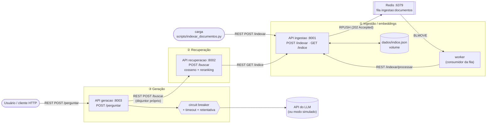
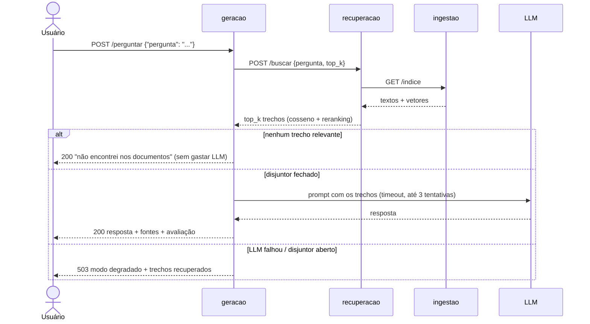

# RAG Distribuído em Microsserviços — C2.A2

**Sistemas Distribuídos e Computação em Nuvem · FAESA · 2026/2**
Prof. Howard Cruz Roatti · Entrega: Aula 12 (29/10/2026)

Sistema de perguntas e respostas com **RAG** (geração aumentada por recuperação) sobre
um conjunto de documentos, decomposto em **três microsserviços independentes** que
conversam por **REST** e por **fila (Redis)**, com a chamada ao LLM protegida por
**circuit breaker, tempo-limite e retentativa**.

Partimos do [kit da disciplina](https://github.com/howardroatti/sd-2026-2-kit-c2a2).
O modelo de embeddings (TF-IDF) e o cliente de LLM são os do kit; o trabalho do grupo
é a engenharia distribuída em volta deles.

---

## Arquitetura



<details>
<summary>Mesmo diagrama em texto (caso o Mermaid não renderize)</summary>

```
                         ┌──────────────────────── ① INGESTÃO ─────────────────────────┐
  carga ──POST /indexar──►  API ingestao :8001 ──RPUSH──► [ Redis: fila ] ──BLMOVE──►  │
  (documentos/*.txt)     │        ▲     │                                     worker   │
                         │        │     └── dados/indice.json (volume)          │      │
                         │        └──────────── POST /indexar/processar ────────┘      │
                         └───────────────────────────▲─────────────────────────────────┘
                                                     │ GET /indice
                         ┌──── ② RECUPERAÇÃO ──────┐ │
                         │  API recuperacao :8002  ├─┘
                         │  cosseno + reranking    │
                         └───────────▲─────────────┘
                                     │ POST /buscar (timeout + disjuntor)
  usuário ──POST /perguntar──► ┌─────┴──── ③ GERAÇÃO ────────┐
                               │  API geracao :8003          │──► API do LLM
                               │  disjuntor + timeout +      │    (ou modo simulado)
                               │  retentativa c/ backoff     │
                               └─────────────────────────────┘
```
</details>

### Os três serviços

| Serviço | Porta | Responsabilidade | Endpoints |
|---|---|---|---|
| **ingestao** (+ **worker**) | 8001 | Recebe documentos, gera os vetores TF-IDF e mantém o índice persistido em disco | `POST /indexar` (enfileira), `GET /indice`, `GET /saude` |
| **recuperacao** | 8002 | Vetoriza a pergunta, compara por similaridade do cosseno e devolve os *top_k* trechos (com reranking) | `POST /buscar`, `GET /saude` |
| **geracao** | 8003 | Busca os trechos, monta o prompt e chama o LLM com resiliência; cita as fontes e avalia a resposta | `POST /perguntar`, `GET /saude` |
| redis | 6379 | Fila de mensagens da etapa de ingestão | — |

Cada serviço tem seu próprio `Dockerfile`, processo e porta, e só fala com os outros
pela rede. Não há banco nem memória compartilhada: a recuperação lê o índice pela API
da ingestão (`GET /indice`), e a geração só conhece a recuperação.

### Fluxo de uma pergunta



---

## Comunicação

- **REST (síncrono)**: geração → recuperação → ingestão, todos com FastAPI.
- **Mensageria (assíncrono)**: a indexação passa por uma **fila no Redis**.
  `POST /indexar` só publica a mensagem e responde **202 Accepted** na hora; o
  **worker** consome a fila e pede a indexação. Se a ingestão estiver ocupada ou fora
  do ar, os documentos esperam na fila em vez de se perderem.

A fila segue o padrão **reliable queue** (ver `servicos/ingestao/worker.py`):

| Lista no Redis | Papel |
|---|---|
| `ingestao:documentos` | fila principal |
| `ingestao:processando` | mensagem que o worker pegou (`BLMOVE` atômico). Se o worker morrer no meio, ela volta para a fila quando ele reinicia |
| `ingestao:falhas` | *dead letter*: mensagens que nunca vão dar certo (JSON inválido, 4xx) |

Falhas transitórias (ingestão fora, tempo-limite, 5xx) devolvem a mensagem para a fila.
Isso dá entrega **pelo menos uma vez**; por isso a ingestão é **idempotente**: um trecho
com a mesma origem e o mesmo texto de um já indexado é ignorado.

## Resiliência

Na chamada ao LLM (`servicos/geracao/app.py`) as três proteções trabalham juntas:

```
disjuntor.chamar( com_retentativa( gerar(..., timeout=LLM_TIMEOUT) ) )
```

| Mecanismo | Onde | Comportamento |
|---|---|---|
| **Tempo-limite** | `comum/llm.py` (`LLM_TIMEOUT`, 20 s) | Cada tentativa desiste se o LLM não responder a tempo |
| **Retentativa** | `comum/resiliencia.py` | Até `LLM_TENTATIVAS` (3) tentativas com recuo exponencial (0,5 s → 1 s → 2 s, com *jitter*). Só repete falhas transitórias: conexão, tempo-limite, 429 e 5xx. Um 401 (chave inválida) não é repetido |
| **Circuit breaker** | `comum/circuit_breaker.py` | Após `LLM_LIMITE_FALHAS` (3) perguntas que falharam seguidas, **abre** e recusa na hora, sem chamar o LLM. Após `LLM_ESPERA_SEGUNDOS` (20 s) fica **meio aberto** e deixa passar **uma** chamada de teste: se ela der certo, fecha |

A retentativa fica **dentro** do disjuntor: uma pergunta faz até 3 tentativas e, se
todas falharem, o disjuntor conta **uma** falha. Com o circuito aberto nem a primeira
tentativa é feita (falha rápida).

O disjuntor do kit foi adaptado para ser **thread-safe**: o FastAPI executa os
endpoints em um pool de threads, então as transições de estado usam uma trava, e no
estado meio aberto só uma requisição de teste passa por vez.

**Degradação elegante:** se o LLM falhar ou o circuito estiver aberto, `/perguntar`
responde **503** com `"modo": "degradado"`, mas ainda entrega os trechos e as fontes
recuperados. Sem `LLM_API_KEY` o sistema usa o **modo simulado** do kit e funciona
100 % offline.

Outras proteções:
- A chamada geração → recuperação tem tempo-limite e **um disjuntor próprio** (uma
  dependência fora do ar não contamina o disjuntor da outra).
- A recuperação traduz a queda da ingestão em **503** claro.
- O índice é gravado de forma **atômica** (arquivo temporário + `os.replace`) e
  recarregado ao iniciar.
- `GET /saude` da geração mostra o estado dos dois disjuntores.

---

## Como executar do zero

### Opção 1 — Docker Compose (recomendado)

Requisitos: Docker Desktop (ou Docker Engine + Compose v2) e Git.

```bash
git clone https://github.com/Eduardo-0806/Sistemas_Distribuidos_C2_A2.git
cd Sistemas_Distribuidos_C2_A2
cp .env.example .env          # Windows (cmd): copy .env.example .env
docker compose up --build -d
```

Isso sobe `redis`, `ingestao`, `worker`, `recuperacao` e `geracao`, e roda o serviço
`carga`, que envia os arquivos de `documentos/` para a fila e termina.
Confira:

```bash
docker compose ps              # carga aparece como "exited (0)": é esperado
docker compose logs worker     # "Documentos processados: {'novos': 12, ...}"
curl http://localhost:8001/saude
```

Faça uma pergunta:

```bash
curl -X POST http://localhost:8003/perguntar -H "Content-Type: application/json" \
  -d '{"pergunta":"o que diz o teorema CAP?"}'
```

No **PowerShell**:

```powershell
Invoke-RestMethod -Method Post -Uri http://localhost:8003/perguntar `
  -ContentType "application/json" -Body '{"pergunta":"o que diz o teorema CAP?"}'
```

Também dá para testar tudo pelo navegador, na documentação automática do FastAPI:
<http://localhost:8003/docs>, <http://localhost:8002/docs> e <http://localhost:8001/docs>.

Para parar: `docker compose down` (o índice e a fila ficam nos volumes).
Para apagar tudo, inclusive o índice: `docker compose down -v`.

### Opção 2 — Sem Docker (para desenvolver)

Requisitos: Python 3.12+ e um Redis rodando em `localhost:6379`
(o mais fácil é `docker run -d -p 6379:6379 redis:7-alpine`).

```bash
python -m venv .venv
source .venv/bin/activate        # Windows: .venv\Scripts\activate
pip install -r requirements.txt

# um terminal para cada processo, na raiz do projeto:
uvicorn servicos.ingestao.app:app    --port 8001
python -m servicos.ingestao.worker
uvicorn servicos.recuperacao.app:app --port 8002
uvicorn servicos.geracao.app:app     --port 8003

# indexe os documentos e pergunte:
python scripts/indexar_documentos.py
curl -X POST http://localhost:8003/perguntar -H "Content-Type: application/json" \
  -d '{"pergunta":"como funciona o circuit breaker?"}'
```

Fora do Docker o `.env` não é lido automaticamente: defina as variáveis no terminal
se quiser mudar algo (ex.: `export LLM_API_KEY=...`).

### Usar um LLM de verdade (opcional)

Coloque a chave no `.env` (que está no `.gitignore`, **nunca** no código):

```
LLM_API_KEY=sk-...
LLM_API_URL=https://api.openai.com/v1/chat/completions
LLM_MODELO=gpt-4o-mini
```

e recrie a geração: `docker compose up -d geracao`. Qualquer API compatível com o
formato de *chat completions* da OpenAI funciona.

### Indexar outros documentos

Coloque arquivos `.txt` em `documentos/` (cada parágrafo vira um trecho) e rode
`docker compose run --rm carga`, ou envie direto para a API:

```bash
curl -X POST http://localhost:8001/indexar -H "Content-Type: application/json" \
  -d '[{"texto":"gRPC usa HTTP/2 e Protocol Buffers.","origem":"anotacoes"}]'
```

---

## Exemplo de resposta

`POST /perguntar {"pergunta": "o que diz o teorema CAP?"}` → **200**

```json
{
  "pergunta": "o que diz o teorema CAP?",
  "resposta": "[MODO SIMULADO - sem LLM_API_KEY configurada]\nPergunta: o que diz o teorema CAP?\nCom base nos documentos recuperados: [teorema_cap.txt] O teorema CAP afirma que, diante de uma particao de rede, ...",
  "modo": "simulado",
  "fontes": ["teorema_cap.txt"],
  "trechos": [
    {"texto": "O teorema CAP afirma que, diante de uma particao de rede, ...",
     "origem": "teorema_cap.txt", "score": 0.2735, "score_rerank": 0.6368}
  ],
  "avaliacao": {"cobertura": 1.0, "fundamentacao": 0.94, "fundamentada": true}
}
```

Com o LLM fora do ar → **503**, mas com os trechos:

```json
{
  "pergunta": "o que diz o teorema CAP?",
  "resposta": null,
  "erro": "LLM indisponivel (ConnectionError)",
  "modo": "degradado",
  "mensagem": "O gerador de respostas esta indisponivel. Seguem os trechos dos documentos mais relacionados a sua pergunta.",
  "fontes": ["teorema_cap.txt"],
  "trechos": [ ... ],
  "disjuntor": "fechado"
}
```

Pergunta fora do assunto dos documentos (ex.: *"qual a receita de bolo de cenoura?"*)
→ **200** com `"modo": "sem_contexto"`, sem chamar o LLM.

---

## Testando as falhas

Todos estes cenários foram executados pelo grupo antes da entrega.

**1. O disjuntor do LLM abre.** Simule um LLM inacessível no `.env`:

```
LLM_API_KEY=chave-falsa
LLM_API_URL=http://llm-fora-do-ar.invalid/v1/chat/completions
```

`docker compose up -d geracao` e faça a mesma pergunta 4 vezes:

| Pergunta | Resultado | Por quê |
|---|---|---|
| 1ª, 2ª, 3ª | 503 `degradado` em ~1,5 s | 3 tentativas com recuo exponencial cada; o disjuntor conta 1 falha por pergunta |
| 4ª | 503 em milissegundos | disjuntor **aberto**: nem tenta chamar o LLM |
| após 20 s | uma chamada de teste passa | **meio aberto**: se falhar, abre de novo; se der certo, fecha |

Acompanhe em `curl http://localhost:8003/saude` e em `docker compose logs -f geracao`
(aparecem as linhas `tentativa 1/3 falhou ... nova tentativa em 0.5s`).
Para voltar ao normal, esvazie `LLM_API_KEY` e rode `docker compose up -d geracao`.
Com uma chave real, o mesmo acontece ao **desligar a internet**.

**2. Derrubar a recuperação.** `docker compose stop recuperacao` → `/perguntar`
responde 503 `servico de recuperacao indisponivel`; da 4ª vez em diante o disjuntor da
recuperação está aberto. `docker compose start recuperacao` → volta em até 10 s.

**3. Derrubar a ingestão com documentos na fila.** `docker compose stop ingestao`,
publique algo na fila (`docker compose exec redis redis-cli rpush ingestao:documentos
'[{"texto":"teste de fila","origem":"teste"}]'`) e veja o worker reenfileirar
(`docker compose logs -f worker`: `Falha transitoria ... volta para a fila`).
`docker compose start ingestao` → o documento é indexado e nada se perde.

**4. Persistência.** `docker compose restart ingestao` → `GET /saude` continua com o
mesmo número de documentos (o índice é recarregado do volume).

**5. Idempotência.** Rode `docker compose run --rm carga` de novo → o worker registra
`'novos': 0, 'ignorados': 12`.

---

## Decisões de projeto

- **Por que a fila na ingestão?** É a etapa naturalmente assíncrona: indexar não precisa
  de resposta imediata, pode demorar (recalcula o TF-IDF de tudo) e não deve se perder
  se o serviço cair. Já a pergunta é síncrona (o usuário espera a resposta), então
  REST é o natural.
- **Por que só a ingestão grava o índice?** Um único dono do dado evita escrita
  concorrente de vários processos no mesmo arquivo. O worker não escreve no disco: ele
  chama a API da ingestão, que serializa as escritas com uma trava.
- **Por que a recuperação reajusta o TF-IDF a cada busca?** O TF-IDF é determinístico:
  ajustar com os mesmos textos reproduz o vocabulário da ingestão, então a pergunta cai
  no mesmo espaço vetorial sem estado compartilhado. Funciona bem para o tamanho deste
  trabalho; com muitos documentos o próximo passo seria um cache invalidado por versão
  do índice, ou um banco vetorial.
- **CAP:** a recuperação lê o índice pela rede a cada busca; se a ingestão cair, o
  sistema prefere **consistência** (responde 503) a responder com um índice
  desatualizado guardado em cache.
- **Retentativa dentro do disjuntor:** as tentativas de uma mesma pergunta contam como
  uma falha, então o disjuntor reage ao número de usuários afetados, e com ele aberto
  as retentativas não sobrecarregam um LLM já fora do ar.

## Extensões opcionais implementadas

- [x] **Persistência** do índice em disco (volume `indice_dados`), com escrita atômica.
- [x] **Reranking** (`servicos/recuperacao/app.py`): a busca vetorial pega 3 × *top_k*
  candidatos e um segundo estágio os reordena pela proporção de palavras-chave da
  pergunta presentes em cada trecho; trechos que só coincidem em palavras vazias
  ("que", "o", "de") são descartados. Desligável com `"rerank": false` no `/buscar`.
- [x] **Citação das fontes**: campo `fontes` (e `origem` de cada trecho); o prompt
  enviado ao LLM rotula cada trecho com o documento de origem.
- [x] **Avaliação automática simples** (`servicos/geracao/avaliacao.py`):
  `cobertura` (quanto da pergunta os trechos cobrem) e `fundamentacao` (quanto da
  resposta está nos trechos), ambos de 0 a 1.

---

## Estrutura do projeto

```
├── servicos/
│   ├── comum/
│   │   ├── embeddings.py        # do kit: vetorização TF-IDF offline
│   │   ├── llm.py               # do kit: cliente do LLM com modo simulado + timeout
│   │   ├── circuit_breaker.py   # disjuntor (adaptado: thread-safe, 1 teste no meio aberto)
│   │   ├── resiliencia.py       # retentativa com recuo exponencial
│   │   └── texto.py             # palavras-chave (reranking e avaliação)
│   ├── ingestao/
│   │   ├── app.py               # ① API: /indexar (fila), /indice, persistência
│   │   ├── worker.py            # ① consumidor da fila (reliable queue)
│   │   └── Dockerfile
│   ├── recuperacao/
│   │   ├── app.py               # ② busca por cosseno + reranking
│   │   └── Dockerfile
│   └── geracao/
│       ├── app.py               # ③ /perguntar: disjuntores, retentativa, degradação
│       ├── avaliacao.py         # avaliação automática da resposta
│       └── Dockerfile
├── scripts/indexar_documentos.py  # carga dos .txt (só biblioteca padrão)
├── documentos/                    # base de documentos de teste
├── docker-compose.yml
├── .env.example
└── TAREFAS.md
```

## Variáveis de ambiente

| Variável | Padrão | Serviço |
|---|---|---|
| `LLM_API_KEY` | vazio = modo simulado | geracao |
| `LLM_API_URL` / `LLM_MODELO` | OpenAI / `gpt-4o-mini` | geracao |
| `LLM_TIMEOUT` | 20 (s, por tentativa) | geracao |
| `LLM_TENTATIVAS` | 3 | geracao |
| `LLM_LIMITE_FALHAS` | 3 | geracao |
| `LLM_ESPERA_SEGUNDOS` | 20 | geracao |
| `URL_RECUPERACAO` | `http://localhost:8002` | geracao |
| `URL_INGESTAO` | `http://localhost:8001` | recuperacao, worker, carga |
| `REDIS_URL` | `redis://localhost:6379/0` | ingestao, worker |
| `ARQUIVO_INDICE` | `dados/indice.json` | ingestao |

## Integrantes

- Eduardo Lopes: tarefas 1 e 2
- Henrique Risciere: tarefas 3 e 4
- Arthur Salume Sobral: tarefas 5 e 6, resiliência complementar e extensões
